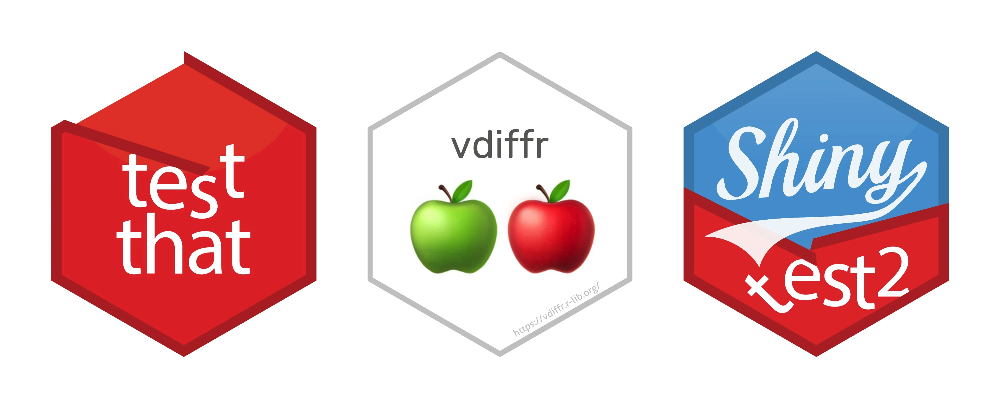
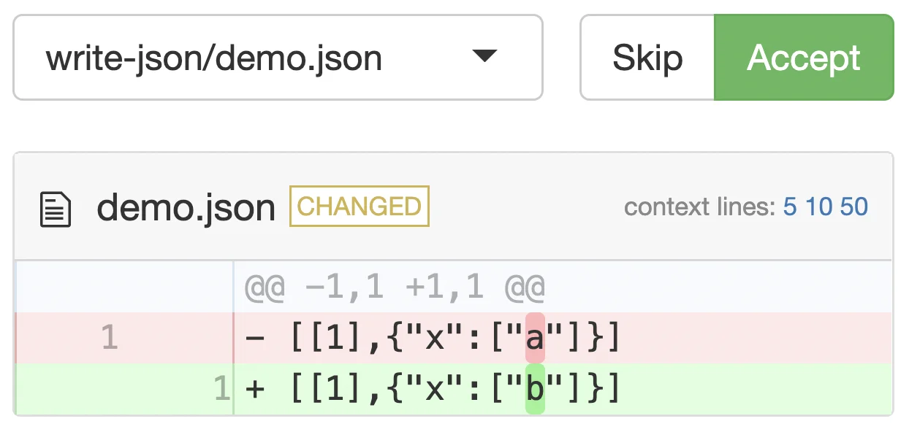
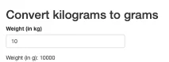

---
format:
  revealjs:
    css: style.css
    theme: simple
    revealjs-plugins:
      - a11y
    revealjs-a11y:
      # 0.2.3's menus introduce ARIA failures; retain our slide-menu handling.
      slide-menu-a11y: false
      menu: false
      # Use the extension's core accessibility fixes without extra UI/shortcuts.
      font-size-controls: false
      font-selection: false
      text-spacing: false
      transcript: false
      slide-change-cue: false
    slide-number: true
    code-line-numbers: false
    code-link: true
    preview-links: auto
    keyboard: true
    touch: true
    help: true
    include-in-header: meta-tags.html
    include-after-body: accessibility.html
    link-external-newwindow: true
execute:
  echo: true
  eval: true
keywords: ["snapshot testing", "testthat", "shinytest2", "vdiffr", "r programming"]
description-meta: "A comprehensive guide to snapshot testing in R using testthat, vdiffr, and shinytest2. Learn how to test text outputs, graphical outputs, and Shiny applications with automated testing."
license: "CC0 1.0 Universal"
pagetitle: "Introduction to Snapshot Testing in R"
author-meta: "Indrajeet Patil"
date-meta: "2022-08-05"
lang: "en"
dir: "ltr"
image: "media/social-media-card.webp"
image-alt: "Preview image for presentation about snapshot testing in R"
canonical-url: "https://www.indrapatil.com/intro-to-snapshot-testing/"
---

## Introduction to Snapshot Testing in R {style="margin-top: 1em;"}

::: {style="margin-top: 0.5em; margin-bottom: 0.5em; font-size: 1em"}

Indrajeet Patil

:::


::: {style="margin-top: 1em; font-size:0.75em"}

{.absolute width="750" height="300" fig-alt="Logos for testthat, vdiffr, and shinytest2."}

:::

::: footer
Source code for these slides can be found [on GitHub](https://github.com/IndrajeetPatil/intro-to-snapshot-testing/).
:::


::: {.notes}
- Welcome the audience to this presentation on snapshot testing in R.
- Introduce the core ecosystem: `{testthat}` for test organisation and text snapshots, `{vdiffr}` for visual regression testing of graphical outputs, and `{shinytest2}` for automated testing of Shiny applications.
- Point out that the complete source code, slides, and reproducible examples are available on GitHub via the repository link in the footer.
:::

## Unit testing {.smaller}

The goal of a unit test is to capture the *expected* output of a function using *code* and making sure that *actual* output after any changes matches the expected output.

[`{testthat}`](https://testthat.r-lib.org/) is a popular framework for writing unit tests in R. 

:::: {.columns}

::: {.column width='60%'}

:::{.callout-important}

## Benefits of unit testing

- insures against unintentionally changing function behaviour
- prevents re-introducing already fixed bugs
- acts as the most basic form of developer-focused documentation
- catches breaking changes coming from upstream dependencies
- etc.

:::

:::

::: {.column width='40%'}

:::{.callout-tip}

## Test output

Test pass only when actual function behaviour matches expected.

| actual                                 | expected                               | tests                                    |
| :------------------------------------- | :------------------------------------- | :--------------------------------------- |
| <span class="deck-icon deck-icon-2xl deck-icon-regular-file-lines" role="img" aria-label="file lines"></span> | <span class="deck-icon deck-icon-2xl deck-icon-regular-file-lines" role="img" aria-label="file lines"></span> | <span class="deck-icon deck-icon-2xl deck-icon-regular-circle-check" role="img" aria-label="circle check"></span> |
| <span class="deck-icon deck-icon-2xl deck-icon-regular-file" role="img" aria-label="file"></span>       | <span class="deck-icon deck-icon-2xl deck-icon-regular-file-lines" role="img" aria-label="file lines"></span> | <span class="deck-icon deck-icon-2xl deck-icon-regular-circle-xmark" role="img" aria-label="circle xmark"></span> |

:::

:::

::::


::: {.notes}
- Define the fundamental purpose of unit testing: capturing expected function behaviour using executable code assertions and making sure that actual output after code modifications matches those expectations.
- Introduce `{testthat}` as the de facto unit testing framework for R packages.
- Review the core benefits in the callout: insuring against unintentional behavioural regressions, preventing the re-introduction of fixed bugs, serving as developer-focused documentation, and catching breaking changes coming from upstream dependencies.
- Walk through the test output matrix in the second column: a test passes only when actual output strictly matches expected output, and fails whenever discrepancies arise.
:::

## Unit testing with `{testthat}`: A recap {.smaller}

:::: {.columns}

::: {.column width='50%'}

::: {.callout-important}

## Test organization

Testing infrastructure for R package has the following hierarchy:

| Component                                                | Role                                                                  |
| :------------------------------------------------------- | :-------------------------------------------------------------------- |
| <br> <span class="deck-icon deck-icon-2xl deck-icon-regular-file-code" role="img" aria-label="file code"></span> **Test file** | Tests for `R/foo.R` will typically be in `tests/testthat/test-foo.R`. |
| <span class="deck-icon deck-icon-2xl deck-icon-solid-flask" role="img" aria-label="flask"></span> **Tests**                | A single file can contain multiple tests.                             |
| <span class="deck-icon deck-icon-2xl deck-icon-solid-equals" role="img" aria-label="equals"></span> **Expectations**        | A single test can have multiple expectations.                         |

:::

:::

::: {.column width='50%'}

:::{.callout-tip}

## Example test file

- Every test is a call to `testthat::test_that()` function.

- Every expectation is represented by `testthat::expect_*()` function.

- You can generate a test file using `usethis::use_test()` function.

```{.r}
# File: tests/testthat/test-op.R

# test-1
test_that("multiplication works", {
  expect_equal(2 * 2, 4) # expectation-1
  expect_equal(-2 * 2, -4) # expectation-2
})

# test-2
test_that("addition works", {
  expect_equal(2 + 2, 4) # expectation-1
  expect_equal(-2 + 2, 0) # expectation-2
})

...
```

:::

:::

::::


::: {.notes}
- Recap the three-tier structural hierarchy of `{testthat}`: test files (such as `tests/testthat/test-foo.R` for `R/foo.R`), individual tests (`test_that()`), and expectations (`expect_*()`).
- Walk through the example test file `test-op.R`: test 1 verifies multiplication using two `expect_equal()` calls (`2 * 2 == 4` and `-2 * 2 == -4`), while test 2 verifies addition (`2 + 2 == 4` and `-2 + 2 == 0`).
- Mention `usethis::use_test()` as the recommended workflow helper to create or open corresponding test files automatically.
:::

## What is different about snapshot testing?

. . .

A **unit test** records the code to describe expected output.

<br>

(actual) <span class="deck-icon deck-icon-2xl deck-icon-regular-file-code" role="img" aria-label="file code"></span> <span class="deck-icon deck-icon-2xl deck-icon-solid-arrows-left-right" role="img" aria-label="arrows left right"></span> <span class="deck-icon deck-icon-2xl deck-icon-solid-file-code" role="img" aria-label="file code"></span> (expected)

<br>

. . .

A **snapshot test** records expected output in a separate, human-readable file.

<br>

(actual) <span class="deck-icon deck-icon-2xl deck-icon-regular-file-code" role="img" aria-label="file code"></span> <span class="deck-icon deck-icon-2xl deck-icon-solid-arrows-left-right" role="img" aria-label="arrows left right"></span> <span class="deck-icon deck-icon-2xl deck-icon-solid-file-lines" role="img" aria-label="file lines"></span> (expected)


::: {.notes}
- Contrast the philosophy of classical unit tests with snapshot tests.
- In classical unit tests, both the input and the expected output are encoded directly in executable R code assertions within the test file.
- In snapshot tests, the expected output is persisted in a separate, human-readable external file, allowing complex outputs to be compared without cluttering test scripts with sprawling string literals or serialised objects.
:::

## Why do you need snapshot testing?

If you develop R packages and have struggled to 

::: incremental

- test that text output *prints* as expected
- test that an entire file *is* as expected
- test that generated graphical output *looks* as expected
- update such tests *en masse*

::: 

. . .

then you should be excited to know more about *snapshot tests* (aka *golden tests*)! 🤩


::: {.notes}
- Detail the real-world motivations for snapshot testing in R package development.
- Highlight common friction points where classical unit tests fail: testing console text formatting, verifying full file exports, validating visual appearance of graphics, and updating dozens of test expectations en masse when deliberate design changes occur.
- Explain that snapshot tests, also known as golden tests in other programming languages, solve these exact maintenance challenges.
:::

# Prerequisites

Familiarity with writing unit tests using [`{testthat}`](https://testthat.r-lib.org/index.html).

If not, have a look at [this](https://r-pkgs.org/testing-basics.html) chapter from *R Packages* book.

:::{.callout-note}

## Package versions assumed

Examples in these slides assume `{testthat}` ≥ 3.3.2, `{vdiffr}` ≥ 1.0.8, and `{shinytest2}` ≥ 0.5.1.

:::


::: {.notes}
- Introduce the prerequisites for this workshop: familiarity with writing baseline unit tests using `{testthat}`.
- Direct attendees unfamiliar with unit testing to the 'Testing basics' chapter in the *R Packages* book by Hadley Wickham and Jenny Bryan.
- Emphasise the assumed minimal package versions noted in the callout: `{testthat}` >= 3.3.2, `{vdiffr}` >= 1.0.8, and `{shinytest2}` >= 0.5.1.
:::

# Testing text outputs

Snapshot tests can be used to test that text output *prints* as expected.

Important for testing functions that pretty-print R objects to the console, create elegant and informative exceptions, etc.


::: {.notes}
- Transition to the first major topic: snapshot testing for text and console outputs.
- Explain that this technique is indispensable for functions that pretty-print custom R objects, output formatted CLI messages, or construct informative error and warning conditions.
:::

## Example function {.smaller aria-label="Text snapshots: Example function"}

Let's say you want to write a unit test for the following function:

:::: {.columns}

::: {.column width='60%'}

**Source code**

```{r}
print_movies <- function(keys, values) {
  paste0(
    "Movie: \n",
    paste0("  ", keys, ": ", values, collapse = "\n")
  )
}
```

:::

::: {.column width='40%'}

**Output**

```{r}
cat(print_movies(
  c("Title", "Director"),
  c("Salaam Bombay!", "Mira Nair")
))
```

:::

::::

. . .

<br>

Note that you want to test that the printed output *looks* as expected. 

Therefore, you need to check for all the little bells and whistles in the printed output.


::: {.notes}
- Walk through the `print_movies()` utility function, which takes vectors of `keys` and `values` and formats them with `paste0()` into indented console text headed by `'Movie: \n'`.
- Examine the printed output for `'Title'` ('Salaam Bombay!') and `'Director'` ('Mira Nair').
- Stress that the testing goal is to verify that the printed representation looks visually correct with proper indentation, prefixes, and line breaks.
:::

## Example test {.smaller}

Even testing this simple function is a bit painful because you need to keep track of every escape character, every space, etc. 

```{r, echo=FALSE}
library(testthat)
# Allow snapshot creation in CI for presentation purposes
Sys.setenv(CI = "false")
```


```{r}
test_that("`print_movies()` prints as expected", {
  expect_equal(
    print_movies(
      c("Title", "Director"),
      c("Salaam Bombay!", "Mira Nair")
    ),
    "Movie: \n  Title: Salaam Bombay!\n  Director: Mira Nair"
  )
})
```

. . .

With a more complex code, it'd be impossible for a human to reason about what the output is supposed to look like.

. . .

:::{.callout-important}

If this is a utility function used by many other functions, changing its behaviour would entail *manually* changing expected outputs for many tests.

This is not maintainable! 😩

:::


::: {.notes}
- Show how a traditional unit test using `expect_equal()` asserts on `print_movies()`.
- Point out the awkward escaped string literal `"Movie: \n  Title: Salaam Bombay!\n  Director: Mira Nair"`, which is tedious to write and mentally parse.
- Highlight the maintenance warning in the callout: if this utility function is shared across multiple package routines, any styling adjustment requires manually updating hard-coded strings across numerous test files.
:::

## Alternative: Snapshot test {.smaller}

Instead, you can use `expect_snapshot()`, which, when run for the first time, generates a Markdown file with expected/reference output.

```{r include = FALSE}
snapper <- local_snapshotter()
snapper$start_file("slides.qmd", "test")
```

```{.r}
test_that("`print_movies()` prints as expected", {
  expect_snapshot(cat(print_movies(
    c("Title", "Director"),
    c("Salaam Bombay!", "Mira Nair")
  )))
})
```

```{r}
#| echo: false
suppressWarnings(test_that("`print_movies()` prints as expected", {
  expect_snapshot(cat(print_movies(
    c("Title", "Director"),
    c("Salaam Bombay!", "Mira Nair")
  )))
}), classes = "testthat_warn")
```

```{r, include = FALSE}
# Reset snapshot test
snapper$end_file()
snapper$start_file("slides.qmd", "test")
```

. . .

:::{.callout-warning}

The first time a snapshot is created, it becomes *the truth* against which future function behaviour will be compared. 

Thus, it is **crucial** that you carefully check that the output is indeed as expected. 🔎 

:::


::: {.notes}
- Introduce `expect_snapshot()` as the modern alternative that automatically records console output when executed for the first time.
- Note the temporary suppression of CI restrictions via `Sys.setenv(CI = 'false')` used in this deck to demonstrate snapshot generation.
- Stress the critical warning: the initial snapshot becomes the authoritative truth against which all future runs are judged, requiring careful manual verification before committing.
:::

## Human-readable Markdown file {.smaller}

Compared to your unit test code representing the expected output

```r
"Movie: \n  Title: Salaam Bombay!\n  Director: Mira Nair"
```

notice how much more human-friendly the Markdown output is!

```md
Code
  cat(print_movies(c("Title", "Director"), c("Salaam Bombay!", "Mira Nair")))
Output
  Movie: 
    Title: Salaam Bombay!
    Director: Mira Nair
```

It is easy to *see* what the printed text output is *supposed* to look like. In other words, snapshot tests are useful when the *intent* of the code can only be verified by a human.

. . . 

:::{.callout-note}

## More about snapshot Markdown files

- If test file is called `test-foo.R`, the snapshot will be saved to `tests/testthat/_snaps/foo.md`.

- If there are multiple snapshot tests in a single file, corresponding snapshots will also share the same `.md` file.

- By default, `expect_snapshot()` will capture the code, the object values, and any side-effects.

:::


::: {.notes}
- Compare the opaque escaped string literal with the cleanly formatted Markdown file generated in `tests/testthat/_snaps/slides.md`.
- Show how the Markdown representation clearly separates the evaluated expression (`cat(print_movies(...))`) from the resulting rendered output.
- Review the storage rules in the callout: snapshot files live under `tests/testthat/_snaps/`, multiple tests within `test-foo.R` share `_snaps/foo.md`, and snapshots capture code, evaluated values, and console side-effects by default.
:::

## What test success looks like {.smaller aria-label="Text snapshots: What test success looks like"}

If you run the test again, it'll succeed:

```{r}
test_that("`print_movies()` prints as expected", {
  expect_snapshot(cat(print_movies(
    c("Title", "Director"),
    c("Salaam Bombay!", "Mira Nair")
  )))
})
```

```{r, include = FALSE}
# Reset snapshot test
snapper$end_file()
snapper$start_file("slides.qmd", "test")
```

. . .

<br>

:::{.callout-note}

### Why does my test fail on a re-run?

If testing a snapshot you just generated fails on re-running the test, this is most likely because your test is not deterministic. For example, if your function deals with random number generation.

In such cases, setting a seed (e.g. `set.seed(42)`) should help. For volatile text such as temporary paths or timestamps, use the native `transform` argument to normalise the output before comparison.

:::


::: {.notes}
- Demonstrate a succeeding test run when `print_movies()` produces output matching the saved Markdown snapshot.
- Discuss reasons why a newly generated snapshot might unexpectedly fail on immediate re-runs, such as non-deterministic pseudo-random number generation.
- Recommend setting a seed with `set.seed()` or using the `transform` argument to normalise volatile outputs such as dynamic timestamps, process IDs, or temporary file paths.
:::

## What test failure looks like {.smaller aria-label="Text snapshots: What test failure looks like"}

When function changes, snapshot doesn't match the reference, and the test fails:

:::: {.columns}

::: {.column width='35%'}

**Changes to function**

```{.r code-line-numbers="5"}
print_movies <- function(keys, values) {
  paste0(
    "Movie: \n",
    paste0(
      "  ", keys, "- ", values,
      collapse = "\n"
    )
  )
}
```

```{r}
#| echo: false
print_movies <- function(keys, values) {
  paste0(
    "Movie: \n",
    paste0("  ", keys, "- ", values, collapse = "\n")
  )
}
```

<br>

Failure message provides expected (`-`) vs observed (`+`) diff.

:::

::: {.column width='65%'}

**Test failure**

```{.r}
test_that("`print_movies()` prints as expected", {
  expect_snapshot(cat(print_movies(
    c("Title", "Director"),
    c("Salaam Bombay!", "Mira Nair")
  )))
})
```

```{r, echo=FALSE, error=TRUE}
test_that("`print_movies()` prints as expected", {
  expect_snapshot(cat(print_movies(
    c("Title", "Director"),
    c("Salaam Bombay!", "Mira Nair")
  )))
})
```

:::

::::


::: {.notes}
- Demonstrate how `{testthat}` handles a regression when `print_movies()` is altered to format key-value pairs with hyphens (`'  ', keys, '- ', values`) instead of colons.
- Walk through the side-by-side failure diff output, showing how expected text lines are marked with minus signs (`-`) and observed modifications with plus signs (`+`).
:::

## Fixing tests {.smaller aria-label="Text snapshots: Fixing tests"}

Message accompanying failed tests make it explicit how to fix them.

. . . 

- If the change was *deliberate*, you can accept the new snapshot as the current *truth*.

```r
* Run `snapshot_accept('foo.md')` to accept the change
```

- If this was *unexpected*, you can reject the changes, discarding all `.new` snapshot files.

```r
* Run `snapshot_reject('foo.md')` to reject the change
```

- If you are unsure, you can review the changes interactively and decide per snapshot.

```r
* Run `snapshot_review('foo.md')` to interactively review the change
```

. . .

<br>

:::{.callout-tip}

## Fixing multiple snapshot tests

If this is a utility function used by many other functions, changing its behaviour would lead to failure of many tests.

You can update *all* new snapshots with `snapshot_accept()`, or discard them all with `snapshot_reject()`. And, of course, check the diffs to make sure that the changes are expected.

:::


::: {.notes}
- Outline the three standard remediation pathways provided by `{testthat}`: accept, reject, or interactive review.
- Explain running `snapshot_accept()` if the change was intentional, `snapshot_reject()` to discard transient `.new` snapshot files, or `snapshot_review()` for an interactive Shiny-driven inspection.
- Highlight the batch-update tip in the callout: when changes affect shared utility functions, updating or rejecting all snapshots en masse prevents tedious manual interventions.
:::

## Snapshot variants {.smaller}

Sometimes the expected output differs *legitimately* across environments — e.g. on Windows vs. macOS, or across R versions. Rather than maintaining separate test files, you can use **snapshot variants**.

. . .

Pass a `variant` string directly to `expect_snapshot()`:

```{.r}
test_that("f() output on Windows", {
  expect_snapshot(f(), variant = "windows")
})
```

Snapshots are then saved to `_snaps/windows/` instead of `_snaps/`, so each variant gets its own reference file.

. . .

:::{.callout-note}

Variants are most useful when you *know* the output will differ and you want to track each variant explicitly. For output that should be identical everywhere, avoid variants — they multiply the maintenance burden. Delete variant directories when they are no longer used because testthat cannot infer every valid variant in advance.

:::


::: {.notes}
- Introduce snapshot variants via the `variant` argument in `expect_snapshot()` for legitimate cross-platform or cross-R-version disparities (e.g. Windows versus macOS path delimiters or error messages).
- Explain that variants are stored in dedicated subdirectories such as `_snaps/windows/`.
- Review the caution in the callout: avoid unnecessary variants as they multiply maintenance overhead, and remember to clean up stale variant directories manually when environments are retired.
:::

## Capturing messages and warnings {.smaller}

So far you have tested text output printed to the console, but you can also use snapshots to capture messages, warnings, and errors.

:::: {.columns}

::: {.column width='50%'}

**message**

```{.r}
f <- function() message("Some info for you.")

test_that("f() messages", {
  expect_snapshot(f())
})
```

```{r}
#| echo: false
f <- function() message("Some info for you.")
suppressWarnings(test_that("f() messages", {
  expect_snapshot(f())
}), classes = "testthat_warn")
```

:::

::: {.column width='50%'}

**warning**

```{.r}
g <- function() warning("Managed to recover.")

test_that("g() warns", {
  expect_snapshot(g())
})
```

```{r}
#| echo: false
g <- function() warning("Managed to recover.")
suppressWarnings(withr::with_options(list(warn = 1), {
  test_that("g() warns", {
    expect_snapshot(g())
  })
}), classes = "testthat_warn")
```

:::

::::

:::{.callout-tip}

Snapshot records both the *condition* and the corresponding *message*.

You can now rest assured that the users are getting informed the way you want! 😌

:::


::: {.notes}
- Demonstrate that `expect_snapshot()` captures signalling conditions, including `message()` and `warning()`.
- Walk through the side-by-side code blocks showing function `f()` raising an informational message and function `g()` raising a warning.
- Highlight the callout tip: snapshots capture both the condition signal and the corresponding message text, noting that recording specific condition classes requires explicitly opting in via `cnd_class = TRUE`.
:::

## Capturing errors {.smaller}

In case of an error, the function `expect_snapshot()` itself will produce an error.

You can capture it:

```{.r code-line-numbers="3"}
test_that("`log()` errors", {
  expect_snapshot(log("x"), error = TRUE)
})
```

```{r, echo=FALSE}
suppressWarnings(test_that("`log()` errors", {
  expect_snapshot(log("x"), error = TRUE)
}), classes = "testthat_warn")
```


::: {.notes}
- Explain how to capture expected errors using `expect_snapshot(..., error = TRUE)`.
- Point out that omitting `error = TRUE` causes the test runner to abort with an unhandled exception when an error is thrown.
- Note the example where `log('x')` produces a non-numeric argument error, demonstrating how the snapshot documents the exact error message text.
:::

## Further reading {.smaller aria-label="Text snapshots: Further reading"}

- `{testthat}` article on [snapshot testing](https://testthat.r-lib.org/articles/snapshotting.html)

- Introduction to [golden testing](https://ro-che.info/articles/2017-12-04-golden-tests)

- Docs for [Jest](https://jestjs.io/docs/snapshot-testing) library in JavaScript, which inspired snapshot testing implementation in `{testthat}`


::: {.notes}
- Direct attendees to additional resources for mastering text snapshots.
- Recommend the official `{testthat}` article on snapshotting, the conceptual guide to golden testing by Roman Cheplyaka, and the Jest documentation in JavaScript, which served as the conceptual inspiration for R's implementation.
:::

# Testing graphical outputs

To create graphical expectations, you will use `{testthat}` extension package: [`{vdiffr}`](https://vdiffr.r-lib.org/).


::: {.notes}
- Transition to the second module: visual regression testing for graphical outputs in R packages.
- Introduce `{vdiffr}`, the `{testthat}` extension package that brings snapshot testing capabilities to graphical objects.
:::

## How does `{vdiffr}` work? {.smaller}

`{vdiffr}` introduces `expect_doppelganger()` to generate `{testthat}` expectations for graphics. It does this by writing SVG snapshot files for outputs!

. . . 

The figure to test can be:

- a `ggplot` object (from `ggplot2::ggplot()`)
- a `recordedplot` object (from `grDevices::recordPlot()`)
- any object with a `print()` method

. . . 

:::{.callout-note}

- If test file is called `test-foo.R`, the snapshot will be saved to `tests/testthat/_snaps/foo` folder.

- In this folder, there will be one `.svg` file for every test in `test-foo.R`.

- The name for the `.svg` file will be sanitized version of `title` argument to `expect_doppelganger()`.

:::


::: {.notes}
- Explain the mechanism behind `{vdiffr}` and its primary expectation function, `expect_doppelganger()`.
- Describe how visual regressions are detected by serialising graphical figures into Scalable Vector Graphics (SVG) snapshot files and comparing them against saved references.
- Clarify the supported graphical inputs: `ggplot` objects, `recordedplot` objects from base graphics, or any R object implementing a `print()` method.
- Review snapshot storage rules: test file `test-foo.R` stores SVGs in `tests/testthat/_snaps/foo/`, named using a sanitised version of the test title.
:::

## Example function {.smaller aria-label="Graphical snapshots: Example function"}

Let's say you want to write a unit test for the following function:

:::: {.columns}

::: {.column width='50%'}

**Source code**

```{r}
library(ggplot2)

create_scatter <- function() {
  ggplot(mtcars, aes(wt, mpg)) +
    geom_point(size = 3, alpha = 0.75) +
    geom_smooth(method = "lm")
}
```
:::

::: {.column width='50%'}

**Output**

```{r}
#| out.width: "100%"
#| fig-alt: "Scatterplot of fuel economy (mpg) versus vehicle weight (wt) in mtcars, with a downward-sloping fitted line and a confidence band."
create_scatter()
```

:::

::::

. . .

Note that you want to test that the graphical output *looks* as expected, and this expectation is difficult to capture with a unit test.


::: {.notes}
- Walk through the `create_scatter()` example function, which constructs a `{ggplot2}` scatterplot of `mpg` versus `wt` from `mtcars` with `geom_point(size = 3, alpha = 0.75)` and a linear regression smoother `geom_smooth(method = 'lm')`.
- Discuss why traditional unit tests struggle to validate plots: asserting on internal list structures of ggplot objects is brittle and fails to capture visual layout, scaling, font rendering, or graphical artefacts.
:::

## Graphical snapshot test {.smaller}

You can use `expect_doppelganger()` from `{vdiffr}` to test this!

. . .

The *first time* you run the test, it'd generate an `.svg` file with expected output.

```{r include = FALSE}
library(vdiffr)

snapper <- local_snapshotter()
snapper$start_file("slides.qmd", "test")
```

```{.r}
test_that("`create_scatter()` plots as expected", {
  expect_doppelganger(
    title = "create scatter",
    fig = create_scatter(),
  )
})
```

```{r}
#| echo: false
suppressWarnings(test_that("`create_scatter()` plots as expected", {
  expect_doppelganger(
    title = "create scatter",
    fig = create_scatter(),
  )
}), classes = "testthat_warn")
```

```{r, include = FALSE}
# Reset snapshot test
snapper$end_file()
snapper$start_file("slides.qmd", "test")
```

. . .

:::{.callout-warning}

The first time a snapshot is created, it becomes *the truth* against which future function behaviour will be compared. 

Thus, it is **crucial** that you carefully check that the output is indeed as expected. 🔎 

You can open `.svg` snapshot files in a web browser for closer inspection.

:::


::: {.notes}
- Introduce `expect_doppelganger()` with parameters `title = 'create scatter'` and `fig = create_scatter()`.
- Explain that the first execution creates the initial reference SVG file on disk.
- Emphasise the warning callout: authors must open and inspect newly generated SVG snapshots in a web browser to ensure visual accuracy before committing them as the gold standard.
:::

## What test success looks like {.smaller aria-label="Graphical snapshots: What test success looks like"}

If you run the test again, it'll succeed:

```{r}
test_that("`create_scatter()` plots as expected", {
  expect_doppelganger(
    title = "create scatter",
    fig = create_scatter(),
  )
})
```

```{r, include = FALSE}
# Reset snapshot test
snapper$end_file()
snapper$start_file("slides.qmd", "test")
```


::: {.notes}
- Show that subsequent runs of `expect_doppelganger()` pass silently when the generated SVG matches the stored reference file character-for-character.
- Note that behind the scenes, `{vdiffr}` compares the XML document structure and attributes of the newly rendered SVG against the reference file.
:::

## What test failure looks like {.smaller aria-label="Graphical snapshots: What test failure looks like"}

When function changes, snapshot doesn't match the reference, and the test fails:

:::: {.columns}

::: {.column width='40%'}

**Changes to function**

```{.r code-line-numbers="3"}
create_scatter <- function() {
  ggplot(mtcars, aes(wt, mpg)) +
    geom_point(size = 2, alpha = 0.85) +
    geom_smooth(method = "lm")
}
```

```{r}
#| echo: false
create_scatter <- function() {
  ggplot(mtcars, aes(wt, mpg)) +
    geom_point(size = 2, alpha = 0.85) +
    geom_smooth(method = "lm")
}
```

:::

::: {.column width='60%'}

**Test failure**

```{.r}
test_that("`create_scatter()` plots as expected", {
  expect_doppelganger(
    title = "create scatter",
    fig = create_scatter(),
  )
})

── Failure ('<text>:3'): `create_scatter()` plots as expected ──────────────────
Snapshot of `testcase` to 'slides.qmd/create-scatter.svg' has changed
Run `testthat::snapshot_review('slides.qmd/')` to review changes
Backtrace:
 1. vdiffr::expect_doppelganger(...)
 3. testthat::expect_snapshot_file(...)
Error in `reporter$stop_if_needed()`:
! Test failed
```

:::

::::


::: {.notes}
- Walk through what happens when graphical parameters change in `create_scatter()`: point size is reduced from 3 to 2 and alpha increased from 0.75 to 0.85.
- Examine the test failure trace from `{vdiffr}`, pointing to a mismatch in `slides.qmd/create-scatter.svg` and advising the developer to invoke `testthat::snapshot_review('slides.qmd/')`.
:::

## Fixing tests {.smaller aria-label="Graphical snapshots: Fixing tests"}

For text file types such as `.json`, `.txt`, and `.md`, `{testthat}` now includes a line diff directly in the failure message.

Running `snapshot_review()` launches a Shiny app when you want to inspect and accept or reject changes interactively, or review binary snapshots.

```{r}
#| echo: false
#| out.width: "60%"
knitr::include_graphics("media/shiny_app_graphics.mov")
```


::: {.notes}
- Explain how to inspect graphical failures using `snapshot_review()`.
- Describe the embedded Shiny review interface shown in the video: side-by-side SVG comparisons, an interactive slider to swipe between before and after versions, toggle overlays, and one-click controls to accept or reject changes.
:::

## <span class="visually-hidden">Graphical snapshot failures and variants</span> {#section}

:::{.callout-tip}

## Why are my snapshots for plots failing?! 😔

If tests fail even if the function didn't change, it can be due to any of the following reasons:

- R's graphics engine changed
- `{ggplot2}` itself changed
- non-deterministic behaviour
- changes in system libraries

For these reasons, snapshot tests for plots tend to be fragile and are not run on CRAN machines by default.

:::

:::{.callout-note}

## Graphical snapshot variants

Just like text snapshots, `expect_doppelganger()` supports a `variant` argument for cases where the expected plot legitimately differs across environments:

```{.r}
expect_doppelganger("my plot", fig = my_plot(), variant = "windows")
```

:::


::: {.notes}
- Review common external factors causing plot snapshots to fail unexpectedly: updates to R's graphics engine, upstream changes in `{ggplot2}`, non-deterministic plotting behaviours, and platform-specific system font or rendering libraries.
- Mention why CRAN skips graphical snapshot comparisons by default to avoid false positive check failures across differing build environments.
- Explain that `expect_doppelganger()` supports the `variant` parameter for cases where plots legitimately render differently across operating systems.
:::

## Further reading {aria-label="Graphical snapshots: Further reading"}

- `{vdiffr}` package [website](https://vdiffr.r-lib.org/)


::: {.notes}
- Point attendees to the official `{vdiffr}` package website for advanced configuration options, custom SVG engines, and integration tips with continuous integration pipelines.
:::

# Testing entire files

Whole file snapshot testing makes sure that media, data frames, text files, etc. are as expected.


::: {.notes}
- Transition to the third module: snapshot testing for entire generated files.
- Explain that whole-file snapshots are designed for verifying tabular data exports, JSON APIs, serialised objects, HTML fragments, or binary media.
:::

## Writing test {.smaller}

Let's say you want to test JSON files generated by `jsonlite::write_json()`.

:::: {.columns}

::: {.column width='50%'}

**Test**

```{r include = FALSE}
snapper <- local_snapshotter()
snapper$start_file("slides.qmd", "test")
```

```{.r}
# File: tests/testthat/test-write-json.R
test_that("json writer works", {
  r_to_json <- function(x) {
    path <- tempfile(fileext = ".json")
    jsonlite::write_json(x, path)
    path
  }

  x <- list(1, list("x" = "a"))
  expect_snapshot_file(r_to_json(x), "demo.json")
})
```

```{r}
#| echo: false
suppressWarnings(test_that("json writer works", {
  r_to_json <- function(x) {
    path <- tempfile(fileext = ".json")
    jsonlite::write_json(x, path)
    path
  }

  x <- list(1, list("x" = "a"))
  expect_snapshot_file(r_to_json(x), "demo.json")
}), classes = "testthat_warn")
```

```{r, include = FALSE}
# Reset snapshot test
snapper$end_file()
snapper$start_file("slides.qmd", "test")
```

**Snapshot**

```json
[[1],{"x":["a"]}]
```

:::

::: {.column width='50%'}

:::{.callout-note}

- To snapshot a file, you need to write a helper function that provides its path.

- If a test file is called `test-foo.R`, the snapshot will be saved to `tests/testthat/_snaps/foo` folder.

- In this folder, there will be one file (e.g. `.json`) for every `expect_snapshot_file()` expectation in `test-foo.R`.

- The name for snapshot file is taken from `name` argument to `expect_snapshot_file()`.

:::

:::

::::


::: {.notes}
- Demonstrate `expect_snapshot_file()` using the `r_to_json()` helper function, which writes a nested R list to a temporary file using `jsonlite::write_json()` and returns the file path.
- Explain that `expect_snapshot_file()` moves and tracks this file under `tests/testthat/_snaps/foo/demo.json`.
- Review the callout notes: the test author must provide a helper returning the file path, and files are stored and named according to the test file name and the `name` argument.
:::

## What test success looks like {.smaller aria-label="File snapshots: What test success looks like"}

If you run the test again, it'll succeed:

```{r}
# File: tests/testthat/test-write-json.R
test_that("json writer works", {
  r_to_json <- function(x) {
    path <- tempfile(fileext = ".json")
    jsonlite::write_json(x, path)
    path
  }

  x <- list(1, list("x" = "a"))
  expect_snapshot_file(r_to_json(x), "demo.json")
})
```

```{r, include = FALSE}
# Reset snapshot test
snapper$end_file()
snapper$start_file("slides.qmd", "test")
```


::: {.notes}
- Demonstrate a succeeding file snapshot test where the output written by `r_to_json()` identically matches `demo.json`.
- Reiterate that `{testthat}` performs a file comparison to verify that the byte content or text lines match the committed snapshot.
:::

## What test failure looks like {.smaller aria-label="File snapshots: What test failure looks like"}

If the new output doesn't match the expected one, the test will fail:

```{.r code-line-numbers="11"}
# File: tests/testthat/test-write-json.R
test_that("json writer works", {
  r_to_json <- function(x) {
    path <- tempfile(fileext = ".json")
    jsonlite::write_json(x, path)
    path
  }

  x <- list(1, list("x" = "b"))
  expect_snapshot_file(r_to_json(x), "demo.json")
})
```

```{r, error=TRUE}
#| echo: false
# File: tests/testthat/test-write-json.R
test_that("json writer works", {
  r_to_json <- function(x) {
    path <- tempfile(fileext = ".json")
    jsonlite::write_json(x, path)
    path
  }

  x <- list(1, list("x" = "b"))
  expect_snapshot_file(r_to_json(x), "demo.json")
})
```


::: {.notes}
- Illustrate a file snapshot failure when the data payload in `x` is modified from `'a'` to `'b'`.
- Show how the mismatch triggers an immediate test failure during test execution, alerting the developer that the generated JSON artefact differs from the reference file.
:::

## Fixing tests {.smaller .nostretch aria-label="File snapshots: Fixing tests"}

Running `snapshot_review()` launches a Shiny app which can be used to either accept or reject the new output(s).

```{r}
#| echo: false
#| fig-alt: "JSON snapshot review showing the value of x changing from a to b, with Skip and Accept controls."

```


::: {.notes}
- Review the `snapshot_review()` workflow for file snapshots, pointing to the embedded screenshot showing a JSON diff where `'x': ['a']` changes to `'x': ['b']`.
- Highlight the intuitive review controls: Skip and Accept, which allow developers to inspect changes file-by-file before updating references.
:::

## Further reading {.smaller aria-label="File snapshots: Further reading"}

Documentation for [`expect_snapshot_file()`](https://testthat.r-lib.org/reference/expect_snapshot_file.html)


::: {.notes}
- Direct attendees to the official documentation for `expect_snapshot_file()`.
- Mention advanced options available, such as specifying custom file comparators (e.g. `compare_file_text()` or `compare_file_binary()`) and transform functions.
:::

# Testing Shiny applications

To write formal tests for Shiny applications, you will use `{testthat}` extension package: [`{shinytest2}`](https://rstudio.github.io/shinytest2/).


::: {.notes}
- Transition to the fourth module: automated snapshot testing for Shiny applications in R packages.
- Introduce `{shinytest2}`, the official testing framework built on `{testthat}` and headless browser automation.
:::

## How does `{shinytest2}` work? {.smaller}

`{shinytest2}` uses a Shiny app (how meta! 😅) to record user interactions with the app and generate snapshots of the application's state. Future behaviour of the app will be compared against these snapshots to check for any changes.

. . . 

Exactly how tests for Shiny apps in R package are written depends on how the app is stored.
There are two possibilities, and you will discuss them both separately.

. . . 

<br>

:::: {.columns}

::: {.column width='50%'}

**Stored in `/inst` folder**

```
├── DESCRIPTION
├── R
├── inst
│   └── sample_app
│       └── app.R
```

:::

::: {.column width='50%'}

**Returned by a function**

```
├── DESCRIPTION
├── R
│   └── app-function.R
```

:::

::::

<!-- Don't add an indefinite article; it breaks the phrase into two lines -->


::: {.notes}
- Explain that `{shinytest2}` drives headless Chrome instances using `{chromote}` to simulate user interactions and capture the application's reactive state and visual appearance.
- Contrast the two primary application architectures in R packages: standalone apps placed in the `inst/` folder (such as `inst/sample_app/app.R`) and dynamic apps returned by package functions (in `R/app-function.R`).
:::

# Shiny app in subdirectory 

<br>

```
├── DESCRIPTION
├── R
├── inst
│   └── sample_app
│       └── app.R
```


::: {.notes}
- Introduce testing for the classic directory layout where Shiny applications are stored within subdirectories of the package `inst/` tree.
:::

## Example app {.smaller}

Let's say this app resides in the `inst/unitConverter/app.R` file.

:::: {.columns}

::: {.column width='40%'}

**App**

```{r}
#| echo: false
knitr::include_graphics("media/shiny_app.mov")
```

:::

::: {.column width='60%'}

**Code**

```{.r}
library(shiny)

ui <- fluidPage(
  titlePanel("Convert kilograms to grams"),
  numericInput("kg", "Weight (in kg)", value = 0),
  textOutput("g")
)

server <- function(input, output, session) {
  output$g <- renderText(
    paste0("Weight (in g): ", input$kg * 1000)
  )
}

shinyApp(ui, server)
```

:::

::::


::: {.notes}
- Walk through the kilograms-to-grams unit converter app located at `inst/unitConverter/app.R`.
- Review the UI with `numericInput('kg', 'Weight (in kg)', value = 0)` and `textOutput('g')`, paired with server logic that multiplies kilograms by 1000 to display formatted grams.
- Note the accompanying screen recording illustrating real-time reactive conversion.
:::

## Generating a test {.smaller}

To create a snapshot test, go to the app directory and run `record_test()`.

```{r}
#| echo: false
#| out.width: "60%"
knitr::include_graphics("media/shinytest_record.mov")
```


::: {.notes}
- Introduce `shinytest2::record_test()`, an interactive test recorder that launches the Shiny app in a dedicated browser window.
- Walk through the workflow shown in the video: typing inputs, clicking buttons, recording expectation checkpoints, and exporting generated test scripts.
:::

## Auto-generated artefacts {.smaller}

:::: {.columns}

::: {.column width='60%'}

**Test**

```{.r}
library(shinytest2)

test_that("{shinytest2} recording: unitConverter", {
  app <- AppDriver$new(
  name = "unitConverter", height = 543, width = 426)
  app$set_inputs(kg = 1)
  app$set_inputs(kg = 10)
  app$expect_values()
})

```

:::

::: {.column width='40%'}

**Snapshot**

```{r}
#| echo: false
#| out-width: "100%"
#| fig-alt: "Screenshot of a kilograms-to-grams Shiny app with input 10 kilograms and output 10000 grams."

```

:::

::::

:::{.callout-note}

- `record_test()` saves the test file directly to the package's `tests/testthat/` directory (e.g. `tests/testthat/test-shinytest2.R`). No separate driver script is needed.

- The snapshots are saved in `tests/testthat/_snaps/{test-name}/`. The `{.variant}` subdirectory (e.g. `_snaps/windows-4.1/`) is used when tests produce OS- or R-version-specific output.

:::


::: {.notes}
- Examine the generated test script utilising `AppDriver$new(name = 'unitConverter', height = 543, width = 426)`, `app$set_inputs(kg = 1)`, `app$set_inputs(kg = 10)`, and `app$expect_values()`.
- Review the generated output artefacts: a JSON file capturing reactive inputs, outputs, and exports, alongside high-resolution PNG screenshots.
- Emphasise the modern architecture: tests are saved directly into `tests/testthat/test-shinytest2.R`, and snapshots into `tests/testthat/_snaps/`, avoiding nested inst test suites.
:::

## What test failure looks like {.smaller aria-label="Shiny snapshots: What test failure looks like"}

Let's say, while updating the app, you make a mistake, which leads to a failed test.

**Changed code with mistake**

```{.r code-line-numbers="9"}
ui <- fluidPage(
  titlePanel("Convert kilograms to grams"),
  numericInput("kg", "Weight (in kg)", value = 0),
  textOutput("g")
)

server <- function(input, output, session) {
  output$g <- renderText(
    paste0("Weight (in kg): ", input$kg * 1000) # should be `"Weight (in g): "`
  )
}

shinyApp(ui, server)
```

**Test failure JSON diff**

```{.json code-line-number="6"}
Diff in snapshot file `shinytest2unitConverter-001.json`
< before                            > after                           
@@ 4,5 @@                           @@ 4,5 @@                         
    },                                  },                            
    "output": {                         "output": {                   
<     "g": "Weight (in g): 10000"   >     "g": "Weight (in kg): 10000"
    },                                  },                            
    "export": {                         "export": {    
```


::: {.notes}
- Show what happens when a regression is introduced into the server logic: displaying `'Weight (in kg): '` instead of `'Weight (in g): '`.
- Examine the JSON diff output from `{shinytest2}`, highlighting how lines 4-5 clearly pinpoint the altered string label in the reactive output payload.
:::

## Updating snapshots {.smaller}

Fixing this test will be similar to fixing any other snapshot test you've seen thus far.

`{shinytest2}` provides a Shiny app for comparing the old and new snapshots.

```{r}
#| echo: false
#| out.width: "60%"
knitr::include_graphics("media/shinytest_failure.mov")
```


::: {.notes}
- Explain how to review and update Shiny snapshots using the dedicated comparison tool launched by `{shinytest2}`.
- Walk through the video demo showcasing interactive side-by-side inspection of JSON state diffs and visual screenshot discrepancies.
:::

# Function returns Shiny app

<br>

```
├── DESCRIPTION
├── R
│   └── app-function.R
```


::: {.notes}
- Transition to testing the second architectural pattern: Shiny applications created dynamically and returned by exported package functions.
:::

## Example app and test {.smaller}

`{shinytest2}` can run the package function directly in its background R process. You don't need to create and serialise the Shiny app object first.

:::: {.columns}

::: {.column width='55%'}

**Source code**

```{.r}
# File: R/unit-converter.R
unitConverter <- function() {
  ui <- fluidPage(
    titlePanel("Convert kilograms to grams"),
    numericInput("kg", "Weight (in kg)", value = 0),
    textOutput("g")
  )

  server <- function(input, output, session) {
    output$g <- renderText(
      paste0("Weight (in g): ", input$kg * 1000)
    )
  }

  shinyApp(ui, server)
}
```


:::

::: {.column width='45%'}

**Test file to modify**

```{.r}
# File: tests/testthat/test-unit-converter.R
test_that("unitConverter app works", {
  app <- AppDriver$new(
    unitConverter,
    name = "unit-converter"
  )
  app$set_inputs(kg = 10)
  app$expect_values()
})
```


:::

::::


::: {.notes}
- Walk through `unitConverter()` defined in `R/unit-converter.R`, which constructs and returns a `shinyApp(ui, server)` object.
- Show how the corresponding test file `tests/testthat/test-unit-converter.R` initialises an `AppDriver` directly with `AppDriver$new(unitConverter, name = 'unit-converter')`.
- Highlight the advantage: native function support in `{shinytest2}` executes the function in a background R process without requiring manual serialisation.
:::

## Recording function-based apps {.smaller}

Pass the function itself to `record_test()`:

```{.r}
record_test(unitConverter, name = "unit-converter")
```

The recorder can capture the interactions, but it cannot save a function-based test automatically. Copy the generated commands into the test file, then run `devtools::test_active_file()` to generate snapshots.

:::{.callout-note}

Native function support removes the need to construct and serialise the app object. The copy-paste step remains because the recorder cannot write a reusable function reference into the generated test.

:::


::: {.notes}
- Explain how to record tests for function-based apps by running `record_test(unitConverter, name = 'unit-converter')`.
- Detail the practical workflow: record interactions interactively, copy the generated driver commands into your test file, and run `devtools::test_active_file()` to generate snapshot files.
- Review the callout note explaining why manual copying is necessary: the interactive recorder cannot infer how the function reference should be resolved across package namespaces.
:::

## One package-level test layout {.smaller}

Package authors should keep every Shiny test in the package's existing `tests/testthat/` infrastructure, whether an app is stored under `inst/` or returned by a function.

```
├── inst
│   └── sample_app
│       └── app.R
├── R
│   └── unit-converter.R
└── tests
    ├── testthat
    │   ├── _snaps
    │   │   ├── app-sample_app
    │   │   │   └── sample_app-001.json
    │   │   └── unit-converter
    │   │       └── unit-converter-001.json
    │   ├── test-app-sample_app.R
    │   └── test-unit-converter.R
    └── testthat.R
```

There is no nested `inst/.../tests/` tree and no package-level driver test. For multiple apps, use one ordinary test file per app.


::: {.notes}
- Advocate for the canonical single package-level testing layout where all tests reside in `tests/testthat/`.
- Review the directory tree showing `_snaps/app-sample_app/` and `_snaps/unit-converter/` living side by side under `tests/testthat/_snaps/`.
- Emphasise that developers should never maintain nested test suites inside `inst/` or rely on complex package-level wrapper scripts.
:::

## Advanced topics {.smaller}

The following are some advanced topics that are beyond the scope of the current presentation, but you may wish to know more about.

:::{.callout-tip}

## Extra

- If you want to test Shiny apps with continuous integration using `{shinytest2}`, read [this](https://rstudio.github.io/shinytest2/articles/use-ci.html) article.

- `{shinytest2}` is a successor to `{shinytest}` package. If you want to migrate from the latter to the former, have a look at [this](https://rstudio.github.io/shinytest2/articles/z-migration.html).

:::


::: {.notes}
- Introduce advanced considerations for production Shiny testing.
- Point attendees to the callout links: configuring headless browsers and system dependencies for continuous integration pipelines in `{shinytest2}`, and step-by-step guidance for migrating legacy test suites from `{shinytest}` to `{shinytest2}`.
:::

## Further reading {.smaller aria-label="Shiny snapshots: Further reading"}

- [Testing](https://mastering-shiny.org/scaling-testing.html) chapter from *Mastering Shiny* book

- `{shinytest2}` article introducing its [workflow](https://rstudio.github.io/shinytest2/articles/shinytest2.html)

- `{shinytest2}` article on how to test apps in [R packages](https://rstudio.github.io/shinytest2/articles/use-package.html)


::: {.notes}
- Recommend foundational literature for testing Shiny applications.
- Direct attendees to the testing chapter in Hadley Wickham's *Mastering Shiny* and the official `{shinytest2}` workflow and package testing guides.
:::

# Headaches 

It's not all kittens and roses when it comes to snapshot testing. 

Let's see some issues you might run into while using them. 🤕


::: {.notes}
- Introduce the practical challenges and pitfalls associated with snapshot testing.
- Remind attendees that while snapshot tests offer great power, they introduce specific maintenance trade-offs and operational headaches that developers must actively manage.
:::

## Testing behaviour that you don't own {.smaller}

Let's say you write a graphical snapshot test for a function that produces a `ggplot` object. If `{ggplot2}` authors make some modifications to this object, your tests will fail, even though your function works as expected!

In other words, *your* tests are now at the mercy of *other package authors* because snapshots are capturing things beyond your package's control.

:::{.callout-caution}

Tests that fail for reasons other than what they are testing for are problematic. Thus, be careful about *what* you snapshot and keep in mind the maintenance burden that comes with dependencies with volatile APIs.

:::

:::{.callout-note}

*A* way to reduce the burden of keeping snapshots up-to-date is to [automate this process](https://github.com/krlmlr/actions-sync/tree/base/update-snapshots). But there is no free lunch in this universe, and now you need to maintain this automation! 🤷

:::


::: {.notes}
- Explain the hazard of testing behaviour owned by external dependencies: if `{ggplot2}` or another upstream package changes internal representations, your snapshot tests will fail despite your code functioning perfectly.
- Discuss the caution callout: snapshotting volatile third-party structures ties package maintenance to external release cycles.
- Review the automation note: while tools like GitHub Actions snapshot-sync workflows can automate updating snapshots, they introduce infrastructure maintenance of their own.
:::

## Failures in non-interactive environments {.smaller}

If snapshots fail locally, you can just run `snapshot_review()`, but what if they fail in non-interactive environments (on CI/CD platforms, during `R CMD Check`, etc.)?

The easiest solution is to download the new snapshots to your local folder and run `snapshot_review()`.

:::{.callout-tip}

If expected snapshot is called (e.g.) `foo.svg`, there will be a new snapshot file `foo.new.svg` in the same folder when the test fails.

`snapshot_review()` compares these files to reveal how the outputs have changed.

:::

:::{.callout-important}

## New snapshots must be created locally first

`expect_snapshot()` **intentionally fails on CI** when it encounters a *new* snapshot that has never been committed — this signals that you forgot to run the tests locally before pushing.

Always run your tests locally first and commit the generated snapshot files before opening a pull request.

:::

But where can you find the new snapshots?


::: {.notes}
- Discuss the operational challenge when snapshot tests fail in non-interactive environments such as continuous integration servers or during `R CMD check`.
- Explain that failed tests generate `.new` snapshot files alongside the reference files.
- Emphasise the critical callout: `expect_snapshot()` deliberately fails on CI when encountering a brand new snapshot, preventing unverified outputs from being committed remotely; all snapshots must be created locally first.
:::

## Accessing new snapshots {.smaller}

In local `R CMD Check`, you can find new snapshots in `.Rcheck` folder:

```r
package_name.Rcheck/tests/testthat/_snaps/
```

On [GitHub Actions](https://github.com/r-lib/actions/tree/v2-branch/check-r-package), upload snapshots as artefacts so you can retrieve them:

```yaml
      - uses: r-lib/actions/check-r-package@v2
        with:
          upload-snapshots: true
```

Then download them directly into your local package with `snapshot_download_gh()`:

```{.r}
testthat::snapshot_download_gh()
```

This replaces the manual step of downloading the artefact zip and copying files by hand.


::: {.notes}
- Explain how to retrieve snapshot artefacts generated during non-interactive runs.
- Point out where to find them locally in `package_name.Rcheck/tests/testthat/_snaps/`.
- Walk through retrieving remote CI failures: configure `check-r-package` in GitHub Actions with `upload-snapshots: true`, then run `testthat::snapshot_download_gh()` locally to download and unpack the artefacts directly into your working tree.
:::

## Code review with snapshot tests {.smaller}

Despite snapshot tests making the expected outputs more human-readable, given a big enough change and complex enough output, sometimes it can be challenging to review changes to snapshots. 

How do you review pull requests with complex snapshots changes? 


::: {.notes}
- Frame the difficulties that arise during code review when pull requests include massive changes to snapshot files.
- Pose the central question: how do reviewers effectively assess complex snapshot modifications without getting overwhelmed by voluminous diffs?
:::

## <span class="visually-hidden">Reviewing snapshot changes</span> {#section-1 .smaller}

:::panel-tabset

### Option-1

Use tools provided for code review by hosting platforms (like GitHub).
For example, to review changes in SVG snapshots:

```{r}
#| echo: false
#| out.width: "70%"
knitr::include_graphics("media/github_pr.mov")
```

### Option-2

Locally open the PR branch and play around with the changes to see if the new behaviour makes sense. 🤷 

:::


::: {.notes}
- Contrast the two primary review workflows in the tabset.
- Option 1 leverages code review tooling provided by hosting platforms like GitHub, which offers rich diff views, swipe comparisons, and visual overlays for SVG and image artefacts.
- Option 2 involves pulling the branch locally to run `snapshot_review()` interactively, allowing hands-on inspection of application behaviour and visual diffs.
:::

## Danger of silent failures {.smaller}

Given their fragile nature, most snapshot comparisons are not enforced on CRAN by default. `{testthat}` returns without comparing, `{vdiffr}` does not fail on a mismatch, and `{shinytest2}` skips when an `AppDriver` is initialised.

Although this makes sense, it means that you miss out on anything but a breaking change from upstream dependency. E.g., if `{ggplot2}` (hypothetically) changes how the points look, you won't know about this change until you *happen to* run your snapshot tests again locally or on CI/CD.

Ordinary deterministic unit expectations run on CRAN, on the other hand, and will report failures.

:::{.callout-tip collapse=false appearance='default' icon=true}

A way to insure against such silent failures is to run tests **regularly** on CI/CD platforms (e.g. nightly or weekly builds).

:::


::: {.notes}
- Warn attendees about silent snapshot failures caused by skipped tests on CRAN.
- Explain that `{testthat}` silences snapshot comparisons, `{vdiffr}` avoids failing on mismatches, and `{shinytest2}` skips when `AppDriver` is initialised on CRAN to prevent spurious package archivals.
- Emphasise the callout tip: configure recurring CI schedules (such as nightly or weekly builds) against development versions of dependencies to catch upstream visual regressions before your users encounter them.
:::

# Parting wisdom

What *not* to do


::: {.notes}
- Introduce the concluding summary section focusing on best practices, common anti-patterns, and disciplined rules of thumb for snapshot testing.
:::

## Don't use snapshot tests for *everything* {.smaller}

It is tempting to use them everywhere out of laziness. But they are sometimes inappropriate (e.g. when testing requires external benchmarking).

Let's say you write a function to extract estimates from a regression model.

```{.r}
extract_est <- function(m) m$coefficients
```

Its test should compare results against an external benchmark, and not a snapshot.

:::: {.columns}

::: {.column width='50%'}

**Good**

```{.r}
test_that("`extract_est()` works", {
  m <- lm(wt ~ mpg, mtcars)
  expect_equal(
    extract_est(m)[[1]],
    m$coefficients[[1]]
  )
})
```


:::

::: {.column width='50%'}

**Bad**

```{.r}
test_that("`extract_est()` works", {
  m <- lm(wt ~ mpg, mtcars)
  expect_snapshot(extract_est(m))
})
```

:::

::::


::: {.notes}
- Warn against the anti-pattern of overusing snapshot tests out of convenience.
- Walk through the `extract_est()` example function extracting regression coefficients: deterministic calculations belong in standard `expect_equal()` assertions compared against external benchmarks, not snapshots.
- Emphasise that relying on snapshots for numerical results masks unintended mathematical regressions and defeats the purpose of rigorous unit verification.
:::

## Snapshot for humans, not machines {.smaller}

Snapshot testing is appropriate when the human needs to be in the loop to make sure that things are working as expected. Therefore, the snapshots should be human readable.

E.g. if you write a function that plots something:

```{.r}
point_plotter <- function() ggplot(mtcars, aes(wt, mpg)) + geom_point()
```

To test it, you should snapshot the *plot*, and not the underlying *data*, which is hard to make sense of for a human.

:::: {.columns}

::: {.column width='50%'}

**Good**

```{.r}
test_that("`point_plotter()` works", {
  expect_doppelganger(
    "point-plotter-mtcars",
    point_plotter()
  )
})
```

:::

::: {.column width='50%'}

**Bad**

```{.r}
test_that("`point_plotter()` works", {
  p <- point_plotter()
  pb <- ggplot_build(p)
  expect_snapshot(pb$data)
})
```

:::

::::


::: {.notes}
- Reiterate the core mantra: 'Snapshot for humans, not machines.'
- Walk through `point_plotter()`: the good practice is using `expect_doppelganger()` to snapshot the visual plot, which a human reviewer can evaluate; the bad practice is snapshotting the internal `ggplot_build(p)$data` data frame, which is impenetrable and brittle.
:::

## Don't **blindly accept** snapshot changes {.smaller}

Resist formation of such a habit.

`{testthat}` provides tools to make it very easy to review changes, so no excuses! 


::: {.notes}
- Issue a firm warning against developing the reflex to run `snapshot_accept()` without careful scrutiny.
- Remind attendees that accepting changes without understanding why they occurred completely undermines the protection snapshot testing provides.
- Emphasise taking advantage of the rich interactive inspection tools provided by `{testthat}`, `{vdiffr}`, and `{shinytest2}`.
:::

# Self-study 

In this presentation, you deliberately kept the examples and the tests simple. 

To see a more realistic usage of snapshot tests, you can study open-source test suites.


::: {.notes}
- Introduce the self-study module.
- Encourage attendees to examine production-grade, mature open-source repositories to observe how snapshot testing is structured and maintained in large packages.
:::

## Suggested repositories {.smaller}

::: columns

<!-- 1st column -->
::: {.column width="33%"}
### Print outputs

- [`{cli}`](https://github.com/r-lib/cli/tree/main/tests/testthat) (for testing command line interfaces)

- [`{pkgdown}`](https://github.com/r-lib/pkgdown/tree/main/tests/testthat) (for testing generated HTML documents)

- [`{dbplyr}`](https://github.com/tidyverse/dbplyr/tree/main/tests/testthat) (for testing printing of generated SQL queries)

- [`{gt}`](https://github.com/rstudio/gt/tree/master/tests/testthat) (for testing table printing)
:::

<!-- 2nd column -->
::: {.column width="33%"}

### Visualizations

- [`{ggplot2}`](https://github.com/tidyverse/ggplot2/tree/main/tests/testthat)

- [`{ggstatsplot}`](https://github.com/IndrajeetPatil/ggstatsplot/tree/main/tests/testthat)

:::

<!-- 3rd column -->
::: {.column width="33%"}

### Shiny apps 

- [`{shinytest2}`](https://github.com/rstudio/shinytest2/tree/main/tests/testthat)

- [`{designer}`](https://github.com/ashbaldry/designer/tree/dev/tests/testthat)

:::

:::


::: {.notes}
- Walk through the three columns of curated open-source repositories.
- For text and CLI printing: `{cli}` for command line formatting, `{pkgdown}` for generated HTML documentation, `{dbplyr}` for SQL translation, and `{gt}` for table layouts.
- For visualisations: `{ggplot2}` and `{ggstatsplot}`.
- For Shiny applications: `{shinytest2}` and `{designer}`.
:::

# Thank You

And Happy Snapshotting! 😊

<br>
<br>

::: {style="text-align: center; font-size: 0.7em;"}

Check out my other [slide decks](https://www.indrapatil.com/presentations/) on software development best practices

:::

::: {style="text-align: center; font-size: 1em;"}

<a class="deck-icon-link" href="https://www.linkedin.com/in/indrajeet-patil-ph-d-397865174/" aria-label="LinkedIn"><span class="deck-icon deck-icon-brands-linkedin" aria-hidden="true"></span></a>
&nbsp;&nbsp;
<a class="deck-icon-link" href="https://github.com/IndrajeetPatil" aria-label="GitHub"><span class="deck-icon deck-icon-brands-github" aria-hidden="true"></span></a>
&nbsp;&nbsp;
<a class="deck-icon-link" href="mailto:patilindrajeet.science@gmail.com" aria-label="Email"><span class="deck-icon deck-icon-solid-envelope" aria-hidden="true"></span></a>

:::


::: {.notes}
- Conclude the presentation and thank the attendees for their time and participation.
- Encourage attendees to check out additional slide decks on software engineering best practices via the portfolio link.
- Point to the contact icons for connecting on LinkedIn, GitHub, or via email.
:::

## Session information {.smaller}

```{r}
sessioninfo::session_info(include_base = TRUE)
```


::: {.notes}
- Present the session information output from `sessioninfo::session_info(include_base = TRUE)`.
- Highlight the importance of recording package versions, OS specifications, and R build details to ensure full computational reproducibility of the presentation deck and all embedded examples.
:::
